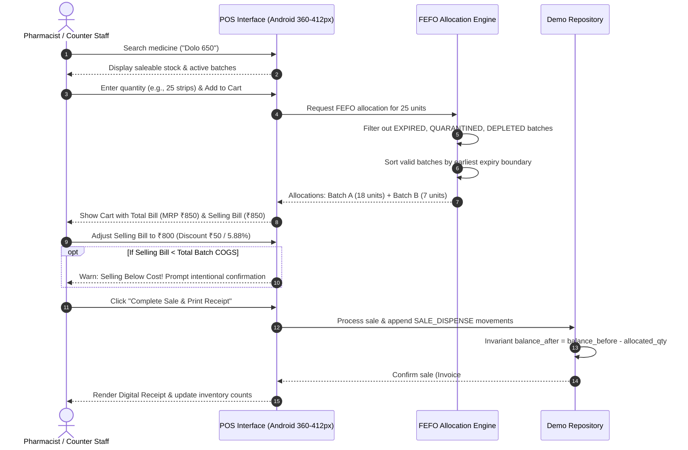

# Medi5 ERP — Stage 3B POS Design Document: Walk-In Counter Sales & FEFO Dispensing

**Document Version:** 1.0.0  
**Status:** Approved for Review  
**Target Milestone:** Stage 3B Counter Sales & POS Prototype  
**Scope:** Architectural specification and component design for mobile-first walk-in pharmacy sales. Implementation is deferred to Stage 3B.

---

## 1. Executive Summary & Objective

Independent retail pharmacies in West Bengal and greater India operate in fast-paced counter environments where walk-in patients require immediate, accurate, and trustworthy dispensing. Counter staff must be able to ring up items in seconds, apply customer discounts transparently, and maintain compliance without manual ledger reconciliation.

The objective of **Stage 3B** is to build a mobile-first Point of Sale (POS) counter-sale workflow directly on top of the Stage 3A inventory model. This design defines how walk-in sales allocate stock across physical batches using **First-Expired, First-Out (FEFO)**, calculate bills with integer-paise precision, prevent overselling or dispensing of expired units, and append immutable audit records to the stock movement ledger.

---

## 2. Boundaries & Deferred Concerns

To ensure focus and architectural clarity, the following boundaries apply:
- **Synthetic Local Demo Only**: Operates in-memory and via versioned `localStorage` (`medi5_demo_inventory_v1`). Real patient data, doctor credentials, and actual drug schedules are simulated with synthetic placeholders.
- **Supabase & Backend Deferred**: Database migrations, backend RPCs, and production auth remain deferred.
- **No Direct Payments**: Payment gateways (UPI QR, Card PoS, Cash Drawer hardware) are simulated via cash/card/UPI tender toggles.
- **No Prescription OCR / Schedule X Workflows**: Complex regulatory prescription logging is deferred to later clinical milestones.

---

## 3. Mobile-First Walk-In Sale Workflow



### Step-by-Step User Journey

1. **Quick Medicine Lookup (Optimized for Android Viewports 360–412px)**:
   - High-contrast search bar with barcode/scanner toggle icon and real-time salt/brand matching.
   - Shows live saleable stock badge (`45 Strips Available`) and indicates if multiple batches will be drawn.
2. **Add to Cart & Quantity Input**:
   - Quick quantity steppers (`+1`, `+5`, `+10`) and manual numeric pad.
   - Instant ceiling validation: cannot add more than total available `saleableQuantity`.
3. **Automatic FEFO Allocation Preview**:
   - Transparent batch distribution displayed under the cart item (e.g. *"Drawing 18 from Lot SYN-DL-24A (Nov 2026) and 7 from Lot SYN-DL-25K (Dec 2027)"*).
4. **Dual-Price Presentation**:
   - **Total Bill (MRP)**: The standard regulatory maximum retail price.
   - **Selling Bill**: The actual price charged to the patient, initially matching Total Bill.
   - Staff can tap the Selling Bill field to enter a negotiated final price or discount percentage.
5. **Below-Cost Safety Interlock**:
   - If Selling Bill is adjusted below the weighted batch purchase cost ($\text{Selling Bill} < \text{COGS}$), an amber warning banner highlights the gross margin loss and requires staff acknowledgment before sale completion.
6. **Confirmation & Receipt Generation**:
   - Single-tap "Confirm Sale" generates a digital cash memo / receipt with unique invoice number, timestamp, itemized batch allocations, total MRP, discount, and net payment.
7. **Atomic Ledger Logging**:
   - Generates an immutable `SALE_DISPENSE` movement for each allocated batch, updating remaining batch quantities and deriving new medicine totals.

---

## 4. Financial & Precision Calculations

To prevent cumulative IEEE 754 floating-point inaccuracies, all monetary calculations are performed in **integer paise** (1 INR = 100 paise) using `src/utils/moneyUtils.ts`.

### Mathematical Formulas

1. **Total Bill (MRP)**:
   $$\text{Total Bill Paise} = \sum_{i=1}^{n} \left( \text{toPaise}(\text{MRP}_i) \times \text{Quantity}_i \right)$$
   $$\text{Total Bill (MRP)} = \text{fromPaise}(\text{Total Bill Paise})$$

2. **Selling Bill**:
   $$\text{Selling Bill} = \text{parseRupees}(\text{UserInputAmount})$$
   $$\text{Selling Bill Paise} = \text{toPaise}(\text{Selling Bill})$$

3. **Discount**:
   $$\text{Discount Paise} = \text{Total Bill Paise} - \text{Selling Bill Paise}$$
   $$\text{Discount Percentage} = \left( \frac{\text{Discount Paise}}{\text{Total Bill Paise}} \right) \times 100$$

4. **Cost of Goods Sold (COGS)**:
   $$\text{COGS Paise} = \sum_{k=1}^{m} \left( \text{toPaise}(\text{PurchaseCost}_k) \times \text{AllocatedQty}_k \right)$$
   $$\text{COGS} = \text{fromPaise}(\text{COGS Paise})$$

5. **Gross Profit & Margin**:
   $$\text{Gross Profit Paise} = \text{Selling Bill Paise} - \text{COGS Paise}$$
   $$\text{Gross Margin \%} = \left( \frac{\text{Gross Profit Paise}}{\text{Selling Bill Paise}} \right) \times 100 \quad (\text{if Selling Bill} > 0)$$

### Quantity & Packaging Representation
- **Units**: Quantities in Stage 3B are represented in whole integer packaging units (`strips`, `bottles`, `vials`, `tubes`).
- **No Fractional Packaging in Initial POS**: Loose tablet dispensing (e.g. cutting a strip into 3 individual tablets) requires tablet-level package size conversion factors and is scheduled as an extension.

---

## 5. POS Safety Rules & Domain Invariants

| Invariant | Safety Rule | Enforcement Mechanism |
|---|---|---|
| **No Dispensing of Unfit Stock** | Expired, quarantined, or depleted batches must never be allocated or sold. | Allocation engine filters strictly by `b.status === 'ACTIVE'`, `b.quantityRemaining > 0`, and `getExpiryUrgency(b.expiryDate, 0) !== 'EXPIRED'`. |
| **No Overselling** | Total requested quantity across cart items cannot exceed current saleable stock. | Cart additions check `cartQty + requested <= saleableQuantity`. Rechecked immediately prior to final checkout commit. |
| **Visible Batch Auditing** | Staff and patients must be able to trace which batch was dispensed. | Each invoice line item stores an array of concrete `BatchAllocation` records showing `batchId`, `batchNumber`, `expiryDate`, and `allocatedQuantity`. |
| **Atomic Inventory Deduction** | A failed sale must never leave partially deducted batches or phantom ledger movements. | `processSale` executes as a pure state transition returning `{ nextState, newSale, movements }`. If validation fails, `demoState` is untouched. |
| **Double-Click Idempotency** | Tapping "Confirm" rapidly must not create duplicate sales or double-dispense batches. | The UI disables the checkout button upon first click and passes an idempotency `clientSaleToken: string`. |
| **Append-Only History** | Returns or voids cannot erase original sale history. | A refunded or cancelled sale generates compensating `CUSTOMER_RETURN` or `SALE_VOID` ledger movements restoring batch balances. |
| **Storage Non-Durability Notice** | Local demo must not claim database guarantees. | The POS header displays: *"Local Demo Mode — Synthetic in-memory sales only. Not a multi-tenant shared database."* |

---

## 6. Target Domain Models (TypeScript Specifications)

```typescript
// Proposed types to be added to src/types/inventory.ts in Stage 3B

export interface BatchAllocation {
  batchId: string;
  batchNumber: string;
  expiryDate: string;
  purchaseCost: number; // in INR
  mrp: number;          // in INR
  quantity: number;     // whole units
}

export interface CartLineItem {
  medicineId: string;
  medicineName: string;
  genericName: string;
  unitLabel: string;
  unitMrp: number;
  requestedQuantity: number;
  allocations: BatchAllocation[];
  lineTotalMrp: number; // in INR
}

export interface SaleSummary {
  id: string; // e.g. "INV-2026-1001"
  clientSaleToken: string;
  timestamp: string; // ISO Date
  items: {
    medicineId: string;
    medicineName: string;
    unitLabel: string;
    quantity: number;
    unitMrp: number;
    allocations: BatchAllocation[];
  }[];
  totalBillMrp: number;    // Standard MRP sum
  sellingBill: number;     // Amount charged
  discountAmount: number;  // Total Bill - Selling Bill
  discountPercent: number;
  cogs: number;            // Total batch purchase cost
  grossProfit: number;     // Selling Bill - COGS
  tenderType: 'CASH' | 'UPI' | 'CARD';
  staffUser: string;
}

export interface ProcessSaleInput {
  clientSaleToken: string;
  cart: CartLineItem[];
  sellingBill: number;
  tenderType: 'CASH' | 'UPI' | 'CARD';
  staffUser?: string;
  confirmedBelowCost?: boolean;
}
```

---

## 7. Stage 3B Test Plan & Acceptance Scenarios

The Stage 3B implementation must provide automated test coverage for:

1. **Single-Batch Dispensing**:
   - Dispensing 5 strips from a batch with 18 units reduces batch to 13 units and logs `SALE_DISPENSE` with `balanceBefore = 18`, `balanceAfter = 13`.
2. **Multi-Batch FEFO Split**:
   - When Medicine A has Lot 1 (10 units, expires Nov 2026) and Lot 2 (20 units, expires Dec 2027), requesting 15 units allocates all 10 from Lot 1 and 5 from Lot 2.
3. **Depletion State Transition**:
   - Dispensing the final unit of a batch transitions `batch.status` from `ACTIVE` to `DEPLETED` with `quantityRemaining = 0`, keeping the batch visible in audit logs.
4. **Oversell Prevention**:
   - Requesting 50 units when only 45 are saleable throws an explicit validation error and leaves inventory unchanged.
5. **Below-Cost Confirmation Safeguard**:
   - Attempting to checkout with $\text{Selling Bill} < \text{COGS}$ without `confirmedBelowCost: true` rejects the sale.
6. **Compensating Return**:
   - Refunding 5 units of a dispensed batch appends a `CUSTOMER_RETURN` movement and increments `quantityRemaining` without modifying the original `SALE_DISPENSE` movement.
7. **Paise Precision Preservation**:
   - Selling 3 items at ₹33.33 with selling bill ₹99.99 computes discount ₹0.00 without floating-point artifacts like ₹0.00000000000001.

---

## 8. Open Architectural Decisions for Stage 3B

1. **Fractional Dispense / Loose Tablets**:
   - *Question*: Should independent pharmacies be allowed to sell fractional packages (e.g., 4 tablets out of a 10-tablet strip)?
   - *Recommendation for Stage 3B*: Restrict the initial prototype to whole packaging units (`strips`), deferring strip-cutting math to Stage 3C to keep invariants simple.
2. **Customer / Patient Contact (Optional vs Anonymous Walk-in)**:
   - *Question*: Should walk-in customers be completely anonymous or prompted for an optional mobile number for digital WhatsApp bills?
   - *Recommendation for Stage 3B*: Allow completely anonymous walk-in sales by default, with an optional "Customer Name/Phone" field for invoice personalization.
3. **Receipt Printing Format**:
   - *Question*: Should receipt rendering support thermal printer ESC/POS format or responsive HTML print view?
   - *Recommendation for Stage 3B*: Implement a responsive CSS `@media print` thermal slip layout (58mm/80mm friendly) that works on both mobile screens and browser print dialogs.
